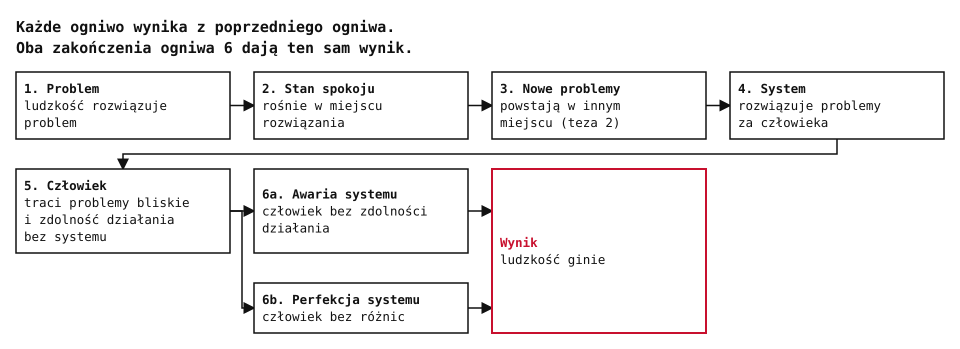
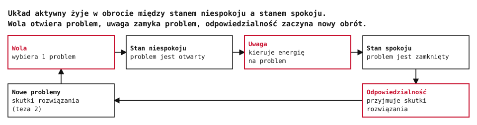

# Perfekcja – koniec ludzkości?

Ten tekst zawiera filozofię w 10 rozdziałach. Tekst jest zapisany w Polszczyźnie Kontrolowanej (PK).

> Legenda: PK to polski z regułami, po których zdanie ma 1 znaczenie. „Lub” znaczy: co najmniej 1 z członów. „Albo” znaczy: dokładnie 1 z członów. POWINIEN to zalecenie. Słowo „Teza” oznacza twierdzenie filozoficzne bez pomiaru. Liczba w indeksie górnym odsyła do przypisu w sekcji „Przypisy”. Liczba w nawiasie okrągłym po słowie „wzór” wskazuje wzór o tym numerze.

## Spis treści

1. [Dlaczego zaczynać od czarnej dziury?](#1-dlaczego-zaczynać-od-czarnej-dziury)
2. [Czy stan spokoju jest przeciwieństwem stanu chaosu?](#2-czy-stan-spokoju-jest-przeciwieństwem-stanu-chaosu)
3. [Dlaczego rozwiązanie tworzy problemy?](#3-dlaczego-rozwiązanie-tworzy-problemy)
4. [Dlaczego problem jest ciekawy?](#4-dlaczego-problem-jest-ciekawy)
5. [Dlaczego pogoń za perfekcją prowadzi do wyginięcia?](#5-dlaczego-pogoń-za-perfekcją-prowadzi-do-wyginięcia)
6. [Czy niewiedza jest błogością?](#6-czy-niewiedza-jest-błogością)
7. [Czy obserwator odróżni człowieka od maszyny?](#7-czy-obserwator-odróżni-człowieka-od-maszyny)
8. [O czym człowiek POWINIEN milczeć?](#8-o-czym-człowiek-powinien-milczeć)
9. [Co proponuje ten tekst?](#9-co-proponuje-ten-tekst)
10. [Do czego prowadzi wszystko?](#10-do-czego-prowadzi-wszystko)

Po rozdziałach stoją 3 sekcje: [Tezy](#tezy), [Decyzje i braki](#decyzje-i-braki), [Przypisy](#przypisy).

## Słownik

| Termin | Definicja | Słowa zakazane dla tego pojęcia |
|---|---|---|
| układ | Układ oznacza zbiór części, który obserwator oddziela od otoczenia granicą. | obiekt, byt |
| układ aktywny | Układ aktywny oznacza układ, który sam pobiera energię z otoczenia i sam wydatkuje energię na utrzymanie różnic. | organizm, istota |
| różnica | Różnica oznacza nierówność wartości 1 wielkości w 2 miejscach układu lub w 2 chwilach. | gradient, napięcie |
| entropia | Entropia oznacza wielkość fizyczną, która rośnie z liczbą możliwych ułożeń części układu. | nieporządek, bałagan |
| stan spokoju | Stan spokoju oznacza wielkość, która rośnie, gdy różnice w układzie maleją. Układ bez różnic ma największy stan spokoju. | cisza, ład |
| stan niespokoju | Stan niespokoju oznacza wielkość, która rośnie, gdy różnice w układzie rosną. | pobudzenie, stres |
| stan chaosu | Stan chaosu oznacza entropię układu. | nieład, zamęt |
| równowaga termodynamiczna | Równowaga termodynamiczna oznacza stan układu, który ma największy stan spokoju. | bezruch |
| problem | Problem oznacza różnicę między stanem obecnym a stanem pożądanym, którą układ aktywny usuwa wydatkiem energii. | kłopot, trudność, zadanie |
| problem ciekawy | Problem ciekawy oznacza problem, który przyciąga uwagę człowieka bez przymusu. | wyzwanie |
| rozwiązanie | Rozwiązanie oznacza działanie, które usuwa 1 problem. | postęp, naprawa |
| perfekcja | Perfekcja oznacza stan, który ma 0 problemów. | doskonałość, ideał |
| wola | Wola oznacza akt, który wybiera 1 problem spośród dostępnych problemów. | chęć, zamiar |
| uwaga | Uwaga oznacza akt, który kieruje energię układu aktywnego na 1 wybrany problem. | skupienie, koncentracja |
| odpowiedzialność | Odpowiedzialność oznacza akt, który przyjmuje skutki rozwiązania jako własne problemy. | wina, obowiązek |
| wola przetrwania | Wola przetrwania oznacza wolę, która wybiera problem utrzymania własnego życia. | instynkt |
| system | System oznacza układ zewnętrzny wobec człowieka, który rozwiązuje problemy za człowieka. | państwo, rynek, sieć |
| maszyna | Maszyna oznacza układ zbudowany przez człowieka, który wykonuje obliczenia. | robot, sztuczna inteligencja |
| wytwór | Wytwór oznacza skutek pracy, który obserwator potrafi zobaczyć lub usłyszeć. | dzieło, produkt |
| obserwator | Obserwator oznacza człowieka, który ocenia układ lub wytwór z zewnątrz. | widz, odbiorca, sędzia |
| obraz | Obraz oznacza zbiór wielkości, które obserwator mierzy z zewnątrz układu. | wygląd, widok |
| cel | Cel oznacza problem lub człowieka, na którego układ aktywny kieruje energię. | obiekt, adresat |
| niewiedza | Niewiedza oznacza różnicę między tym, co człowiek wie, a tym, co istnieje. | ignorancja |
| głupota | Głupota oznacza ograniczenie umysłu, przez które człowiek popełnia błędy. | tępota |
| fizyczność | Fizyczność oznacza zależność człowieka od ciała, które męczy się, głoduje i umiera. | cielesność |
| ludzkość | Ludzkość oznacza zbiór wszystkich żyjących ludzi. | gatunek, cywilizacja |
| czarna dziura | Czarna dziura oznacza obszar przestrzeni, który ma horyzont zdarzeń. | kolapsar |
| horyzont zdarzeń | Horyzont zdarzeń oznacza granicę czarnej dziury, spod której światło nie wraca do obserwatora. | krawędź |
| nic | Nic oznacza stan wszechświata, który ma 0 różnic. | pustka, nicość |

## 1. Dlaczego zaczynać od czarnej dziury?

John Taylor, brytyjski fizyk, wydał w 1973 r. książkę „Black Holes: The End of the Universe?”[^taylor]. Państwowy Instytut Wydawniczy wydał polski przekład w 1987 r. pod tytułem „Czarne dziury – koniec wszechświata?”[^piw]. Książka Taylora opisuje gwiazdę, która zapada się pod własnym ciężarem. Książka Taylora pyta też o los człowieka wobec takiej gwiazdy.

Gwiazda świeci, dopóki ciśnienie gazu równoważy ciężar gwiazdy. Gdy paliwo jądrowe gwiazdy kończy się, ciśnienie spada. Jeżeli pozostała masa gwiazdy jest większa niż 3,2 masy Słońca, to żadna znana siła nie zatrzymuje zapadania[^rhoades]. Gwiazda staje się czarną dziurą.

Czarna dziura ma horyzont zdarzeń. Promień horyzontu zdarzeń podaje wzór:

$$r _{s} = \frac{2GM}{c^{2}} \qquad (1)$$

- $r _{s}$: promień horyzontu zdarzeń, w metrach ($\mathrm{m}$);
- $G$: stała grawitacji, $G = 6{,}674 \times 10^{-11}\ \mathrm{m^{3}\ kg^{-1}\ s^{-2}}$[^codata];
- $M$: masa czarnej dziury, w kilogramach ($\mathrm{kg}$);
- $c$: prędkość światła w próżni, $c = 299\ 792\ 458\ \mathrm{m\ s^{-1}}$[^codata].

Iloczyn $GM$ dla Słońca wynosi $1{,}3271244 \times 10^{20}\ \mathrm{m^{3}\ s^{-2}}$[^iau]. Dla Słońca wzór (1) daje:

$$r _{s} = \frac{2 \cdot 1{,}3271244 \times 10^{20}}{(299\ 792\ 458)^{2}}\ \mathrm{m} = 2953\ \mathrm{m} \qquad (2)$$

Horyzont zdarzeń czarnej dziury o masie Słońca ma więc promień 2,95 km. Światło, które jest pod horyzontem zdarzeń, nie wraca do obserwatora.

Taylor pisze, że w czarnej dziurze podstawowe prawa wszechświata „wydają się zniszczone, razem z naszymi zwykłymi pojęciami przestrzeni i czasu”[^kirkus]. Taylor wnioskuje, że czarna dziura pochłonie w końcu cały wszechświat[^kirkus]. Pytanie w tytule książki Taylora wynika z tego wniosku.

Ten tekst pożycza od Taylora metodę. Każdy rozdział zaczyna się od zjawiska fizycznego. Każdy rozdział przenosi potem zjawisko na człowieka. Przeniesienie jest analogią, a nie dowodem. Taylor pytał o koniec wszechświata. Ten tekst pyta o koniec ludzkości.

## 2. Czy stan spokoju jest przeciwieństwem stanu chaosu?

Herbata o temperaturze 90 °C stygnie w kuchni o temperaturze 20 °C. Herbata stygnie, dopóki herbata i kuchnia mają różne temperatury. Gdy herbata i kuchnia mają tę samą temperaturę, przepływ ciepła ustaje. Układ „herbata i kuchnia” osiąga wtedy największy stan spokoju. Fizyk nazywa największy stan spokoju równowagą termodynamiczną.

Ludwig Boltzmann powiązał entropię z liczbą ułożeń części układu[^boltzmann]:

$$S = k \ln W \qquad (3)$$

- $S$: entropia układu, w dżulach na kelwin ($\mathrm{J\ K^{-1}}$);
- $k$: stała Boltzmanna, $k = 1{,}380649 \times 10^{-23}\ \mathrm{J\ K^{-1}}$[^codata];
- $W$: liczba ułożeń części układu, które dają obserwatorowi ten sam obraz (liczba bez jednostki).

Druga zasada termodynamiki mówi: entropia układu izolowanego nie maleje[^clausius]:

$$\Delta S \ge 0 \qquad (4)$$

- $\Delta S$: zmiana entropii układu izolowanego w każdym odcinku czasu, w dżulach na kelwin ($\mathrm{J\ K^{-1}}$).

Entropia jest największa w równowadze termodynamicznej.

Wzory (3) i (4) dają wniosek sprzeczny z intuicją. Układ w największym stanie spokoju ma największą entropię. Obserwator widzi w takim układzie jednolity obraz bez zdarzeń. Części układu mają wtedy największą liczbę możliwych ułożeń.

**Teza 1.** Jeżeli stan spokoju układu rośnie, to stan chaosu układu rośnie. Brzmienie potoczne tezy 1: „im większy stan spokoju, tym większy stan chaosu”.

Czarna dziura jest przypadkiem skrajnym. Jacob Bekenstein i Stephen Hawking wykazali, że entropia czarnej dziury rośnie z polem horyzontu zdarzeń[^bekenstein]:

$$S _{BH} = \frac{k c^{3} A}{4 G \hbar} \qquad (5)$$

- $S _{BH}$: entropia czarnej dziury, w dżulach na kelwin ($\mathrm{J\ K^{-1}}$);
- $A$: pole horyzontu zdarzeń, w metrach kwadratowych ($\mathrm{m^{2}}$);
- $\hbar$: zredukowana stała Plancka, $\hbar = 1{,}054572 \times 10^{-34}\ \mathrm{J\ s}$[^codata];
- $k$, $c$, $G$: stałe ze wzoru (1) i ze wzoru (3).

Żaden obszar o tym samym polu powierzchni nie pomieści entropii większej niż entropia czarnej dziury[^bousso]. Obserwator z zewnątrz mierzy tylko 3 wielkości czarnej dziury: masę, ładunek i moment pędu[^mtw]. Obserwator widzi więc czarną dziurę jako układ bez różnic. Czarna dziura ma zatem największy stan spokoju i największy stan chaosu.

## 3. Dlaczego rozwiązanie tworzy problemy?

Lodówka chłodzi wnętrze i grzeje kuchnię. Lodówka zmniejsza entropię wnętrza. Lodówka zwiększa w tym samym czasie entropię kuchni. Wzrost entropii kuchni jest większy niż spadek entropii wnętrza[^clausius]:

$$\Delta S _{1} + \Delta S _{2} \gt 0 \qquad (6)$$

- $\Delta S _{1}$: zmiana entropii wnętrza lodówki, liczba ujemna, w dżulach na kelwin ($\mathrm{J\ K^{-1}}$);
- $\Delta S _{2}$: zmiana entropii kuchni, liczba dodatnia, w dżulach na kelwin ($\mathrm{J\ K^{-1}}$).

Układ aktywny działa jak lodówka. Układ aktywny zmniejsza entropię w 1 miejscu. Układ aktywny zwiększa entropię otoczenia. Erwin Schrödinger opisał w 1944 r. życie w ten sam sposób: żywa komórka obniża własną entropię kosztem otoczenia[^schrodinger].

Problem jest różnicą. Rozwiązanie usuwa różnicę w 1 miejscu. Druga zasada termodynamiki przenosi koszt rozwiązania w inne miejsce. W innym miejscu powstaje nowa różnica. Nowa różnica jest nowym problemem.

Przykłady (lista niepełna):

- Antybiotyk rozwiązał problem zakażeń bakteryjnych. Stosowanie antybiotyków wytworzyło bakterie oporne na antybiotyki[^who].
- Silnik spalinowy rozwiązał problem transportu. Spalanie paliw kopalnych zwiększyło stężenie dwutlenku węgla w atmosferze. Stężenie osiągnęło w 2019 r. wartość 410 części na milion[^ipcc]. Stężenie z 2019 r. jest najwyższe od co najmniej 2 000 000 lat[^ipcc].
- Program komputerowy rozwiązuje 1 problem użytkownika. Linia programu jest też miejscem na błąd.

**Teza 2.** Każde nowe rozwiązanie prowadzi do nowych problemów.

Z tezy 2 wynika zalecenie. Człowiek POWINIEN wybierać rozwiązanie o najmniejszej złożoności. Rozwiązanie złożone z 1 części ma 1 miejsce na nowy problem. Rozwiązanie złożone z 10 części ma co najmniej 10 takich miejsc.

## 4. Dlaczego problem jest ciekawy?

Kamień na dnie doliny leży bez ruchu. Kamień na zboczu toczy się w dół. Ruch wymaga różnicy wysokości. Tylko jeżeli różnica istnieje, układ aktywny ma na co wydatkować energię.

Problem daje uwadze człowieka cel. Rozwiązany problem znika. Uwaga człowieka traci wtedy cel.

Zdanie „we are running out of problems to solve” opisuje stan, w którym liczba nierozwiązanych problemów maleje. Przekład zdania: „kończą nam się problemy do rozwiązania”. System usuwa problem głodu, problem zimna i problem odległości. Człowiek dostaje żywność, ciepło i transport od systemu.

Energia człowieka zostaje po zniknięciu problemu. Energia bez celu kieruje się na najbliższy dostępny cel. Najbliższym celem jest drugi człowiek.

**Teza 3.** Problemy do rozwiązania są ciekawe, a liczba problemów do rozwiązania maleje. Ludzie odczuwają dlatego niechęć do innych ludzi. Ludzie odczuwają też niechęć ogólną, czyli niechęć bez celu.

Niechęć ludzi jest więc zrozumiała. Niechęć jest skutkiem braku problemów ciekawych.

## 5. Dlaczego pogoń za perfekcją prowadzi do wyginięcia?

Bateria zasila lampę, dopóki bieguny baterii mają różne potencjały. Bateria bez różnicy potencjałów jest rozładowana. Lampa gaśnie.

Perfekcja jest stanem bez problemów. Stan bez problemów jest stanem bez różnic. Stan bez różnic jest największym stanem spokoju. Według tezy 1 największy stan spokoju jest największym stanem chaosu.

Ciąg przyczynowo-skutkowy ma 6 ogniw. Ogniwa następują w tej kolejności:

1. Ludzkość rozwiązuje problem.
2. Rozwiązanie zwiększa stan spokoju w miejscu rozwiązania.
3. Rozwiązanie tworzy nowe problemy w innym miejscu (teza 2).
4. Ludzkość buduje system, który rozwiązuje nowe problemy za człowieka.
5. Człowiek traci problemy ciekawe. Człowiek traci też zdolność działania bez systemu.
6. System ulega awarii albo system osiąga perfekcję.

Jeżeli system ulega awarii, to człowiek bez zdolności działania ginie. Jeżeli system osiąga perfekcję, to człowiek zostaje bez różnic. Układ aktywny bez różnic przestaje działać, jak rozładowana bateria.

**Teza 4.** Pogoń za perfekcją prowadzi do wyginięcia ludzkości.

Teza 4 jest wnioskiem z analogii. Teza 4 nie ma pomiaru ani daty.

## 6. Czy niewiedza jest błogością?

Ciało człowieka męczy się, głoduje i umiera. Każda z tych 3 własności tworzy różnicę. Ciało odnawia różnice bez udziału woli. Głód wraca po posiłku. Zmęczenie wraca po odpoczynku.

Thomas Gray napisał w 1742 r.: „where ignorance is bliss, 'tis folly to be wise”[^gray]. Przekład: „gdzie niewiedza jest błogością, tam mądrość jest szaleństwem”.

Niewiedza jest różnicą między wiedzą człowieka a światem. Dopóki niewiedza trwa, człowiek ma problem ciekawy. Niewiedza zasłania też człowiekowi koniec, który opisuje rozdział 10.

Umysł człowieka popełnia błędy i zapomina. Błąd tworzy nowy problem. Zapomnienie zwraca człowiekowi problem już rozwiązany.

Maszyna bez ciała nie zna głodu. Maszyna z pełną pamięcią niczego nie zapomina. Maszyna dostaje problem od człowieka.

**Teza 5.** Niewiedza jest błogością. Fizyczność i głupota są dla człowieka błogosławieństwem.

Uzasadnienie tezy 5: fizyczność i głupota odnawiają różnice. Różnice utrzymują człowieka jako układ aktywny.

## 7. Czy obserwator odróżni człowieka od maszyny?

Obserwator z zewnątrz mierzy 3 wielkości czarnej dziury: masę, ładunek i moment pędu[^mtw]. 2 czarne dziury, które mają tę samą masę, ten sam ładunek i ten sam moment pędu, są dla obserwatora identyczne. Pochodzenie czarnej dziury znika pod horyzontem zdarzeń. Obserwator nie odróżni czarnej dziury z gwiazdy od czarnej dziury z biblioteki.

Alan Turing zaproponował w 1950 r. grę w naśladowanie[^turing]. Obserwator rozmawia na piśmie z człowiekiem. Obserwator rozmawia na piśmie także z maszyną. Gdy obserwator myli maszynę z człowiekiem, maszyna wygrywa grę.

Wytwór działa jak horyzont zdarzeń. Obserwator dostaje tekst, rysunek albo głos. Pochodzenie wytworu zostaje za wytworem.

**Teza 6.** W niedługiej przyszłości obserwator nie odróżni człowieka od maszyny po wytworze. Teza 6 obowiązuje od roku `[DO USTALENIA: rok]`.

Wola, uwaga i odpowiedzialność zostają po stronie człowieka. Żaden z tych 3 aktów nie jest widoczny w wytworze. Obserwator nie potwierdzi więc człowiekowi człowieczeństwa. Człowiek sam potwierdza własne człowieczeństwo aktem woli, uwagi i odpowiedzialności.

## 8. O czym człowiek POWINIEN milczeć?

Obserwator z zewnątrz nie dostaje żadnej informacji spod horyzontu zdarzeń. Fizyk, który opisuje wnętrze czarnej dziury, opisuje równania, a nie pomiar.

Ludwig Wittgenstein zakończył „Traktat logiczno-filozoficzny” tezą 7: „O czym nie można mówić, o tym trzeba milczeć”[^wittgenstein].

Język ma własny horyzont zdarzeń. Zdanie o fakcie leży przed horyzontem: człowiek potrafi sprawdzić takie zdanie. Zdanie, którego żaden człowiek nie potrafi sprawdzić, leży za horyzontem.

**Teza 7.** Człowiek POWINIEN milczeć o tym, czego człowiek nie potrafi powiedzieć.

Wykładnia tezy 7 w tym tekście: człowiek potrafi powiedzieć tylko zdanie, które człowiek potrafi sprawdzić. Z tezy 7 wynika zalecenie dla pracy z maszyną. Człowiek POWINIEN żądać od maszyny tylko wyniku, który człowiek potrafi sprawdzić.

Ten tekst stosuje tezę 7 do siebie. Tezy od 1 do 10 włącznie są nazwane tezami. Fakty mają źródła. O roku w tezie 6 tekst milczy.

## 9. Co proponuje ten tekst?

Serce zdrowego dorosłego człowieka bije w spoczynku od 60 do 100 razy na minutę włącznie[^medline]. Serce, które tylko spoczywa, zatrzymuje krążenie. Serce, które tylko drży, też zatrzymuje krążenie. Życie serca jest ruchem między skurczem a rozkurczem.

Układ aktywny żyje tak samo. Gdy różnica rośnie, układ aktywny dąży do stanu spokoju. Gdy różnica znika, układ aktywny dąży do stanu niespokoju. Dążenie jest samoistne: układ aktywny wykonuje dążenie bez polecenia z zewnątrz.

Człowiek potrafi wykonać dążenie świadomie. Świadome wykonanie ma 3 akty:

- Wola wybiera 1 problem.
- Uwaga kieruje energię na wybrany problem.
- Odpowiedzialność przyjmuje skutki rozwiązania, czyli nowe problemy z tezy 2.

**Teza 8.** Akt woli, uwagi i odpowiedzialności jest samoistnym dążeniem układu aktywnego do stanu spokoju i do stanu niespokoju.

Wola prowadzi człowieka do stanu niespokoju: wola otwiera problem. Uwaga prowadzi człowieka do stanu spokoju: uwaga zamyka problem. Odpowiedzialność zaczyna nowy obrót.

System rozwiązuje problemy za człowieka. Człowiek zależny od systemu oddaje systemowi wolę, uwagę i odpowiedzialność. Skutek opisuje rozdział 5.

**Teza 9.** Uniezależnienie człowieka od systemu jest zależnością człowieka od własnej woli przetrwania.

Z tezy 8 i z tezy 9 wynikają 4 zalecenia:

1. Człowiek POWINIEN sam wytwarzać co najmniej 1 z 4 dóbr: żywność, ciepło, wodę, energię.
2. Człowiek POWINIEN przyjąć od systemu tylko rozwiązanie, które człowiek potrafi sprawdzić.
3. Człowiek POWINIEN zostawić sobie co najmniej 1 problem ciekawy.
4. Człowiek POWINIEN wybierać rozwiązanie o najmniejszej złożoności (rozdział 3).

## 10. Do czego prowadzi wszystko?

Taylor opisał koniec, w którym czarna dziura pochłania wszechświat[^kirkus]. Pomiary supernowych z 1998 r. pokazały, że rozszerzanie wszechświata przyspiesza[^riess]. Fizyka opisuje od 1998 r. także inny koniec.

Gwiazdy zużywają paliwo jądrowe i gasną. Czarna dziura traci masę przez promieniowanie Hawkinga[^hawking]. Czarna dziura o masie Słońca paruje dłużej niż $10^{66}$ lat[^hawking]. Po wyparowaniu czarnych dziur wszechświat zawiera tylko rozproszone cząstki o malejącej energii[^adams].

Wszechświat dąży wtedy do stanu, który ma 0 różnic. Wszechświat bez różnic ma największy stan spokoju i największy stan chaosu. Żaden układ aktywny nie działa we wszechświecie bez różnic.

Oba opisy końca dają ten sam wynik: stan bez różnic. Słownik nazywa stan bez różnic słowem „nic”.

**Teza 10.** Wszystko prowadzi do niczego.

Droga do niczego trwa. Na tej drodze człowiek ma problemy, a problemy są ciekawe. O reszcie ten tekst milczy.

## Tezy

1. Jeżeli stan spokoju układu rośnie, to stan chaosu układu rośnie.
2. Każde nowe rozwiązanie prowadzi do nowych problemów.
3. Problemy do rozwiązania są ciekawe, a liczba problemów do rozwiązania maleje. Ludzie odczuwają dlatego niechęć do innych ludzi i niechęć ogólną.
4. Pogoń za perfekcją prowadzi do wyginięcia ludzkości.
5. Niewiedza jest błogością. Fizyczność i głupota są dla człowieka błogosławieństwem.
6. W niedługiej przyszłości obserwator nie odróżni człowieka od maszyny po wytworze.
7. Człowiek POWINIEN milczeć o tym, czego człowiek nie potrafi powiedzieć.
8. Akt woli, uwagi i odpowiedzialności jest samoistnym dążeniem układu aktywnego do stanu spokoju i do stanu niespokoju.
9. Uniezależnienie człowieka od systemu jest zależnością człowieka od własnej woli przetrwania.
10. Wszystko prowadzi do niczego.

## Decyzje i braki

| Nr | Fragment | Reguła | Znaczenia lub brak | Wybór |
|---|---|---|---|---|
| 1 | „w niedługiej przyszłości” (teza 6) | A5, D3 | Brak roku. | `[DO USTALENIA]` |
| 2 | Cały tekst | Granice standardu | PK nie obejmuje literatury. Zlecenie tego tekstu wymaga PK. | Zlecenie ma pierwszeństwo przed regułą. |
| 3 | „im większy stan spokoju, tym większy stan chaosu” | A3, C3 | Postać potoczna tezy 1. Słowo „im” ma 2 znaczenia: spójnik i zaimek. | Teza 1 ma zapis „Jeżeli W, to D.” Postać potoczna stoi w cudzysłowie. |
| 4 | „we are running out of problems to solve” | Granice standardu | Cytat po angielsku. | Cytat stoi bez zmian, z przekładem. |
| 5 | „stan spokoju”, „stan chaosu” | A4 | W języku potocznym oba terminy są bez miary. | Słownik definiuje oba terminy przez różnice i przez entropię. |
| 6 | „O czym nie można mówić, o tym trzeba milczeć” | B1 | Cytat nie nazywa wykonawcy. | Cytat stoi bez zmian. Teza 7 nazywa wykonawcę. |
| 7 | Przeniesienie zjawiska fizycznego na człowieka | F | Brak pomiaru. | Tekst nazywa przeniesienie analogią, a twierdzenie tezą. |
| 10 | Jednostki i stałe we wzorach | D1, E5 | Zapis znakami spoza LaTeX rozdziela liczbę i jednostkę przy składzie. | Każdy wzór, każda stała i każda jednostka ma zapis w LaTeX. Wzory mają numery od (1) do (6) włącznie. |
| 8 | „Wszystko prowadzi do niczego” | A4 | Słowo „nic” ma 2 znaczenia: brak rzeczy; stan bez różnic. | Słownik wybiera znaczenie: stan bez różnic. |
| 9 | Zdanie Taylora o prawach wszechświata | Granice standardu | Polskie wydanie[^piw] nie było dostępne przy pisaniu. | Przekład z angielskiego za recenzją[^kirkus]. |

## Powiązane repozytoria

- [polszczyzna-kontrolowana](https://github.com/maciejszulia/polszczyzna-kontrolowana): reguły PK.
- [tractatus-skills](https://github.com/maciejszulia/tractatus-skills): teza 7 jako 2 kroki pracy z maszyną.
- [traktat-ludzko-sztuczno-inteligencyjny](https://github.com/maciejszulia/traktat-ludzko-sztuczno-inteligencyjny): granica między człowiekiem a maszyną.
- [samowystarczalny-system-do-zycia](https://github.com/maciejszulia/samowystarczalny-system-do-zycia): zalecenie 1 z rozdziału 9 jako projekt.

## Przypisy

[^taylor]: J. G. Taylor, „Black Holes: The End of the Universe?”, Souvenir Press, London 1973.
[^piw]: J. G. Taylor, „Czarne dziury – koniec wszechświata?”, przeł. M. Kalinowski i J. Piesiak, seria „Biblioteka Myśli Współczesnej”, Państwowy Instytut Wydawniczy, Warszawa 1987, ISBN 83-06-01529-0. [Rekord w katalogu Akademickiej Biblioteki Cyfrowej](https://abc.uw.edu.pl/katalog/ksiazka/8618).
[^rhoades]: C. E. Rhoades, R. Ruffini, „Maximum Mass of a Neutron Star”, „Physical Review Letters” 32, 324–327 (1974). [doi:10.1103/PhysRevLett.32.324](https://doi.org/10.1103/PhysRevLett.32.324)
[^codata]: E. Tiesinga, P. J. Mohr, D. B. Newell, B. N. Taylor, „CODATA recommended values of the fundamental physical constants: 2018”, „Reviews of Modern Physics” 93, 025010 (2021). [doi:10.1103/RevModPhys.93.025010](https://doi.org/10.1103/RevModPhys.93.025010). Wartości stałej grawitacji i zredukowanej stałej Plancka są zaokrąglone. Wartości stałej Boltzmanna i prędkości światła są dokładne: wynikają z definicji jednostek układu SI.
[^iau]: A. Prša i 21 współautorów, „Nominal Values for Selected Solar and Planetary Quantities: IAU 2015 Resolution B3”, „The Astronomical Journal” 152, 41 (2016). [doi:10.3847/0004-6256/152/2/41](https://doi.org/10.3847/0004-6256/152/2/41)
[^kirkus]: Recenzja książki J. G. Taylora „Black Holes: The End of the Universe?” w „Kirkus Reviews”, wydanie z 1 kwietnia 1974 r. [Tekst recenzji](https://www.kirkusreviews.com/book-reviews/a/john-taylor-7/black-holes-the-end-of-the-universe/). Recenzja cytuje zdanie Taylora po angielsku. Przekład zdania na polski powstał dla tego tekstu.
[^boltzmann]: L. Boltzmann, „Über die Beziehung zwischen dem zweiten Hauptsatze der mechanischen Wärmetheorie und der Wahrscheinlichkeitsrechnung respektive den Sätzen über das Wärmegleichgewicht”, „Sitzungsberichte der Kaiserlichen Akademie der Wissenschaften in Wien, Mathematisch-Naturwissenschaftliche Classe” 76, 373–435 (1877). Zapis ze stałą Boltzmanna podał M. Planck, „Ueber das Gesetz der Energieverteilung im Normalspectrum”, „Annalen der Physik” 309, 553–563 (1901). [doi:10.1002/andp.19013090310](https://doi.org/10.1002/andp.19013090310)
[^clausius]: R. Clausius, „Ueber verschiedene für die Anwendung bequeme Formen der Hauptgleichungen der mechanischen Wärmetheorie”, „Annalen der Physik” 201, 353–400 (1865). [doi:10.1002/andp.18652010702](https://doi.org/10.1002/andp.18652010702)
[^bekenstein]: J. D. Bekenstein, „Black Holes and Entropy”, „Physical Review D” 7, 2333–2346 (1973). [doi:10.1103/PhysRevD.7.2333](https://doi.org/10.1103/PhysRevD.7.2333). S. W. Hawking, „Particle creation by black holes”, „Communications in Mathematical Physics” 43, 199–220 (1975). [doi:10.1007/BF02345020](https://doi.org/10.1007/BF02345020)
[^bousso]: R. Bousso, „The holographic principle”, „Reviews of Modern Physics” 74, 825–874 (2002). [doi:10.1103/RevModPhys.74.825](https://doi.org/10.1103/RevModPhys.74.825)
[^mtw]: C. W. Misner, K. S. Thorne, J. A. Wheeler, „Gravitation”, W. H. Freeman, San Francisco 1973, rozdział 33.
[^schrodinger]: E. Schrödinger, „What Is Life? The Physical Aspect of the Living Cell”, Cambridge University Press, Cambridge 1944, rozdział 6.
[^who]: Światowa Organizacja Zdrowia (WHO), karta informacyjna [„Antimicrobial resistance”](https://www.who.int/news-room/fact-sheets/detail/antimicrobial-resistance).
[^ipcc]: Międzyrządowy Zespół do spraw Zmian Klimatu (IPCC), „Climate Change 2021: The Physical Science Basis”, część „Summary for Policymakers”, punkt A.1.1 i sekcja A.2, Cambridge University Press, Cambridge 2023. [doi:10.1017/9781009157896.001](https://doi.org/10.1017/9781009157896.001)
[^gray]: T. Gray, „Ode on a Distant Prospect of Eton College”, wiersz napisany w 1742 r., wydany w 1747 r. w Londynie.
[^turing]: A. M. Turing, „Computing Machinery and Intelligence”, „Mind” 59 (236), 433–460 (1950). [doi:10.1093/mind/LIX.236.433](https://doi.org/10.1093/mind/LIX.236.433)
[^wittgenstein]: L. Wittgenstein, „Tractatus logico-philosophicus”, przeł. B. Wolniewicz, Wydawnictwo Naukowe PWN, Warszawa 2000, teza 7.
[^medline]: U.S. National Library of Medicine, encyklopedia MedlinePlus, hasło [„Pulse”](https://medlineplus.gov/ency/article/003399.htm).
[^riess]: A. G. Riess i 19 współautorów, „Observational Evidence from Supernovae for an Accelerating Universe and a Cosmological Constant”, „The Astronomical Journal” 116, 1009–1038 (1998). [doi:10.1086/300499](https://doi.org/10.1086/300499)
[^hawking]: S. W. Hawking, „Black hole explosions?”, „Nature” 248, 30–31 (1974). [doi:10.1038/248030a0](https://doi.org/10.1038/248030a0). D. N. Page, „Particle emission rates from a black hole: Massless particles from an uncharged, nonrotating hole”, „Physical Review D” 13, 198–206 (1976). [doi:10.1103/PhysRevD.13.198](https://doi.org/10.1103/PhysRevD.13.198)
[^adams]: F. C. Adams, G. Laughlin, „A dying universe: the long-term fate and evolution of astrophysical objects”, „Reviews of Modern Physics” 69, 337–372 (1997). [doi:10.1103/RevModPhys.69.337](https://doi.org/10.1103/RevModPhys.69.337)
